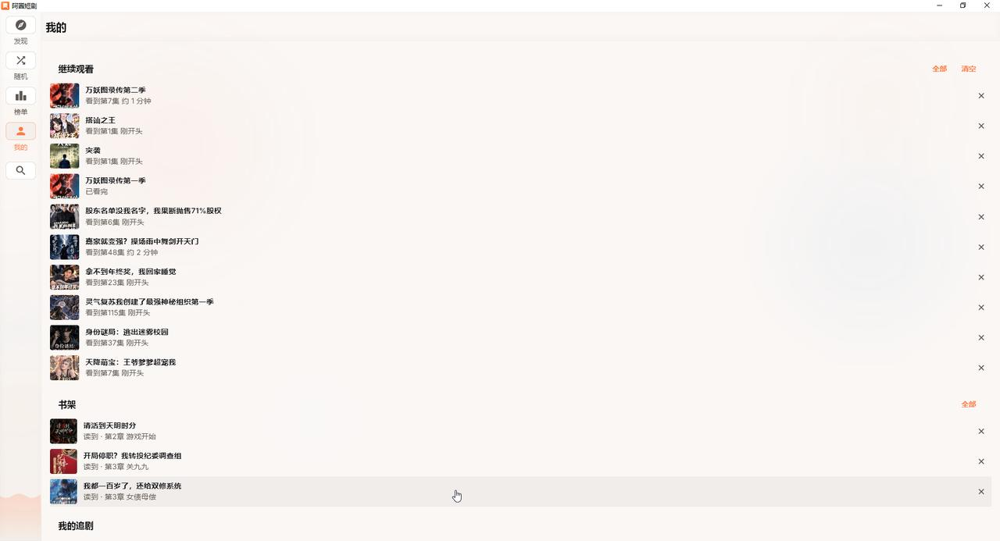
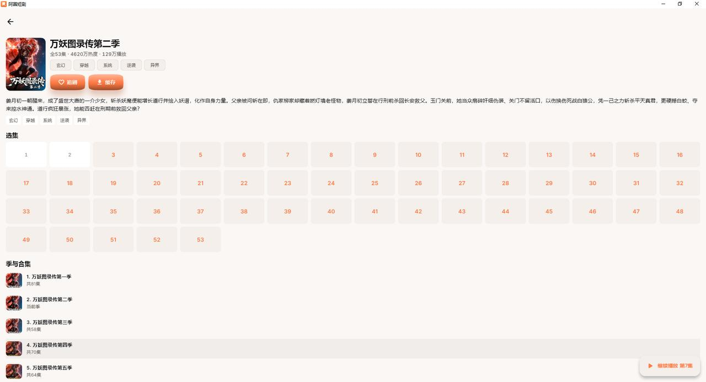
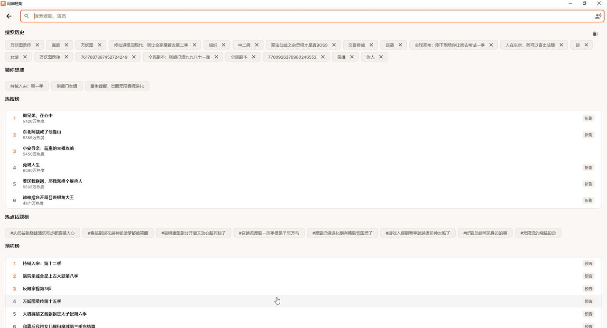
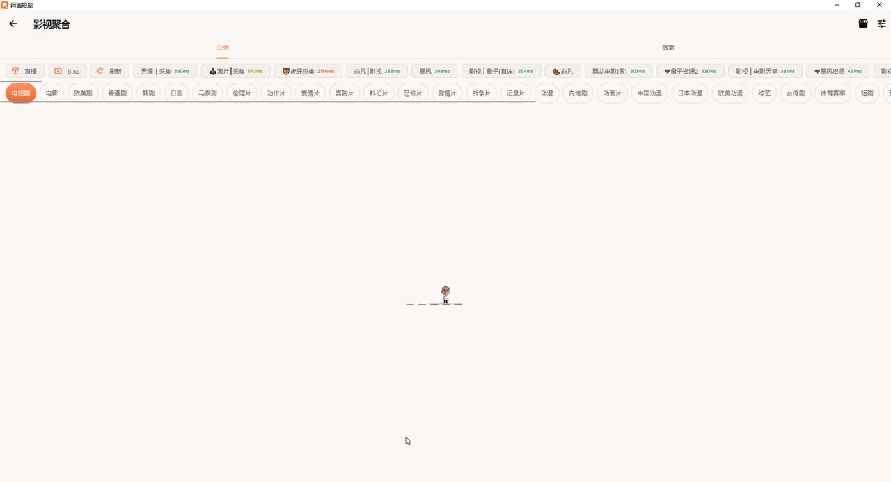

# 阿圈短剧

**一个看短剧的电脑/手机软件。打开就能刷，退出接着看，进度帮你记，剧帮你搜。**

支持 **Windows / Android / macOS / Linux / Android TV**。


> **免责声明**
>
> 本项目仅供学习与研究，禁止用于商业用途。应用内数据来自开源项目 openhongguo
> 逆向的红果短剧公开接口，所有短剧内容的版权归原平台及权利方所有。
> 请勿将本项目用于任何侵犯他人合法权益的用途；使用本项目即表示您同意上述条款。
>
> **第三方影视源与直播配置均由用户自行导入**：应用不内置、不分发任何内容源地址，
> 预置的接口索引站仅是「清单页」入口且可删除。第三方源与直播内容来自用户导入的
> 第三方采集站，请自行确认授权与合法性，使用后果自负。B 站功能依赖用户本人账号
> 登录，请遵守 B 站用户协议。加密分集的解密中继仅处理用户已可播放的内容。

---

## 它能做什么？

### 1. 打开就刷，退出接着看

- 首页每天给你换一批推荐的剧，不想看可以一直划
- 看到一半关掉，下次打开点「继续观看」，从**断点前 3 秒**接着播——不会把上一句台词再听一遍
- 看完的集自动打 ✓，一部剧追到第几集清清楚楚



### 2. 播放器该有的都有

- **弹幕**：能开关、能调半屏/全屏、能屏蔽关键词、同一句刷屏的弹幕还能合并
- **倍速**：0.5 ~ 3 倍随便调，每部剧记住你的偏好；手机上长按画面直接 2 倍速
- **快进快退**：进度条拖动有预览，键盘左右键一次跳 5 秒，鼠标滚轮直接调音量
- **全屏看剧**时控制栏右下角显示**当前时间和星期几**，不用退出全屏看表
- 画质自动选最高（1080p），也支持手动切换清晰度、切换音轨和字幕


### 3. 多季剧，一部接一部

一部剧有几季、每季多少集，详情页列得明明白白；在选集面板里点一下别的季就能看那一季的集数列表。
本季最后一集播完，**自动接着播下一季第 1 集**，追剧不断档。



### 4. 搜索：想到什么搜什么

- 边打字边出提示，不用等搜索按钮
- 搜「万妖图录传」，同一部剧的第一季到第 N 季**按顺序排好**一起给你
- 记不清全名也没关系，搜个开头就能帮你找到



### 5. 影视聚合（进阶玩法）

手上有 TVBox / 采集站的接口地址？填进来，电影、电视剧这些长视频也能聚合搜索、聚合观看。
每个源都显示响应速度，哪个快一目了然。



### 6. 其它贴心功能

- **下载离线**：地铁里、飞机上没网也能看
- **投屏到电视**：支持 DLNA / Chromecast / AirPlay
- **自动检查更新**：有新版本会提醒，点一下就装好
- **小说阅读**：追剧累了还能看书，进度同样帮你记

---

## 让 AI 替你搜、替你播

发布包里带了一个命令行小工具 `aquan-cli`，可以代替你在界面里点来点去：

```powershell
aquan-cli watch 万妖图录传        # 搜关键词，自动开播最匹配的一部
aquan-cli pause                   # 暂停（resume / next / prev 同理）
aquan-cli status                  # 现在播到哪了
aquan-cli cast 万妖图录传          # 直接投屏到电视
```

也可以写进脚本、丢给 AI 助手，让它们帮你找剧、开播、控制播放。

## 怎么下载安装？

到 GitHub 的 [Releases](../../releases) 页面，下载你设备对应的文件：

| 设备 | 下载什么 | 怎么装 |
|---|---|---|
| Windows | `aquan-windows-x64-版本号-setup.exe` 或 `.zip` | 安装包双击安装；zip 解压后双击 `aquan_duanju.exe` |
| Android 手机/电视 | `aquan-arm64-v8a.apk`（主流手机） | 下载后直接安装，提示「未知来源」选允许 |
| Linux | `aquan-linux-x64-版本号.tar.gz` | 解压运行，需系统装有 libmpv |
| macOS | `aquan-macos-arm64-版本号.zip` | 解压，首次右键 → 打开 |

> Windows / macOS 安装包没有开发者签名：SmartScreen / Gatekeeper 弹提示时，
> 选「仍要运行」/「仍要打开」即可。

## 三步上手

1. **打开软件** → 首页点一部剧，直接开始播
2. **看一半关掉**也不怕 → 下次首页「继续观看」点一下接着看
3. **想找某部剧** → 点左边放大镜，输入名字

就这么多，没有第三步之后的事。

## 常见问题

<details>
<summary><b>点开剧播放失败，或者提示「设备被限制」？</b></summary>
到「我的 → 设置 → 重置匿名设备」，然后重新进剧。
</details>

<details>
<summary><b>需要科学上网吗？</b></summary>
正常网络就能用；个别网络环境拉不到内容时，试试给系统挂代理。
</details>

<details>
<summary><b>投屏搜不到电视？</b></summary>
确保电脑/手机和电视连的是<strong>同一个 Wi-Fi</strong>，电视端需支持 DLNA 或已装接收端应用。
</details>

<details>
<summary><b>想自己编译？</b></summary>
装好 Flutter 后：<code>flutter build windows</code> 出 Windows 版，<code>flutter build apk</code> 出安卓版。
更完整的打包脚本在 <code>scripts/</code> 目录。
</details>

---

## 🙏致谢

- [openhongguo](https://github.com/beilunyang/openhongguo) — 红果短剧逆向接口的 Go SDK，
  本项目的数据核心；Apache-2.0。
- [media_kit](https://github.com/media-kit/media-kit) — libmpv 的 Flutter 绑定。
- Windows media_kit 崩溃补丁与播放链路参考了社区先行探索（`packages/` 内带补丁说明）。
- 感谢 [linuxdo](https://linux.do/) 社区的交流、分享与反馈

## LICENSE

Apache License 2.0（见 [LICENSE](LICENSE)）。`native/bridge/vendor/` 内是 openhongguo
的 Apache-2.0 源码副本，版权归属其原作者。
