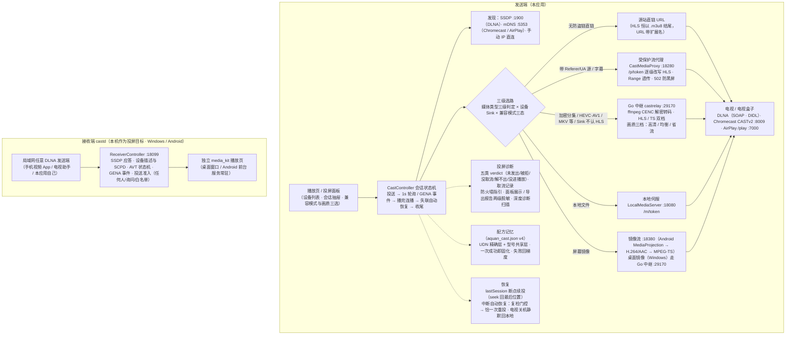

# 阿圈短剧

一个基于 [openhongguo](https://github.com/beilunyang/openhongguo)（红果短剧逆向接口 SDK，
Apache-2.0）的 Flutter 短剧播放器，支持 **Windows / Android / Linux / macOS**。

> **免责声明**
>
> 本项目仅供学习与研究，禁止用于商业用途。应用内数据来自开源项目 openhongguo
> 逆向的红果短剧公开接口，所有短剧内容的版权归原平台及权利方所有。
> 请勿将本项目用于任何侵犯他人合法权益的用途；使用本项目即表示您同意上述条款。
>
> **第三方影视源与直播配置均由用户自行导入**：应用不内置、不分发任何内容源地址，
> 预置的接口索引站仅是「清单页」入口且可删除。第三方源与直播内容来自用户导入的
> 第三方采集站，请自行确认授权与合法性，使用后果自负。B 站功能依赖用户本人账号
> 登录，请遵守 B 站用户协议。加密分集的解密中继仅处理用户已可播放的内容。

## 功能

| 模块 | 说明 |
|---|---|
| 发现 | 推荐流、频道切换（新剧/热剧/漫剧…）、双列瀑布、分页加载 |
| 随机看 | 全屏竖滑 feed，上下滑随机换剧（红果「随机看」的交互） |
| 榜单 | 短剧榜单多内容多榜切换、类型筛选、筛选页、上新日历 |
| 搜索 | 热搜榜、猜你想搜、输入联想、结果分页 |
| 详情 | 简介、演员、分集网格、季与合集、相关推荐、续播 |
| 播放 | 清晰度切换、倍速（0.5–3.0x）、手势、双击快进退、自动连播、CENC 加密分集透明解密 |
| 竖横屏 | 移动端按片源自动转屏；桌面端可让窗口自动适应片源比例 |
| 桌面操作 | 键盘快捷键（空格/←→/↑↓/F/M/I/PageUp/Down…）、双击全屏、窗口记忆、迷你置顶小窗、系统媒体控制（媒体键/音量浮层） |
| 本地 | 观看历史（秒级续播）、追剧收藏、深浅色主题、默认清晰度/倍速、备份恢复、重置匿名设备 |
| AI 代播 | 命令行入口 + `skills/duanju-search-play`，对 AI 说「看短剧 XX」即可搜剧并开播 |
| 影视聚合 | 发现页入口：导入 TVBox / MoonTV / 多仓 / 文本行源（六形态解码含 2423 AES 加密配置），源市场从索引站一键抓源+逐源测速（「连接成功 XXXms」）、聚合搜索（流式先到先显示）、源管理（自检/钉选/排序/导入导出）、短剧源自动标记 |
| B 站 | 扫码登录（免 appkey）、推荐/搜索（WBI 签名 + buvid/bili_ticket 风控）、视频/番剧 DASH 双轨播放、弹幕展示与发送、屏蔽词 |
| 直播 | TVBox lives（TXT/M3U/JSON）：分组换台、备用地址自动切换、逐频道测速、EPG 节目单（XMLTV/xml.gz） |
| 投屏 | **DLNA + Chromecast + AirPlay 三协议**（SSDP+mDNS 双发现，同设备自动换协议降级；AirPlay 一期为经典接收端的 `/play` 视频投送——UxPlay/shairport-sync 系等无需配对的接收端，新电视的 AirPlay 2 `/command` 与配对留二期，音量遥控不支持）；受保护流四级选路（直链/源站头代理/CENC 解密中继/本地文件）；**屏幕镜像**（MediaProjection→H264/AAC→MPEG-TS，含系统声音、编码器卡死自动降档恢复）；B 站 DASH 双轨合流投送；电视端播完自动连播下一集；GENA 事件推送替代高频轮询；静音/音量/字幕（sec:SubtitleUri + VTT）遥控；断开回本地续播；**中断自动恢复**（播放中失联先复检电视可达再恰一次重投并跳回最后位置，电视真关机静默回本地）；**接收端**（Windows/Android：本机可成为手机 App 的投屏目标，见「投屏 · 接收端」） |
| 语音 | 搜索框语音输入：Android 系统识别；桌面 OpenAI 兼容端点（自备 key，设置里配置与自检） |
| 去广告 | CMS 源播放经本地回环代理重写 m3u8（关键字表剔广告分片），失败自动回退直链 |
| 扫码导入 | 源管理页生成一次性二维码，手机浏览器粘贴配置提交导入 |
| JS 爬虫源 | 影视聚合支持 .js 爬虫源双口味自动识别（CatVod 长名 / FongMi 短名同步 req），ES 模块加载器 + 打包 lib（cheerio/crypto-js/gbk），播放二次解析 |
| 漫画源 | 发现页（小说频道）漫画源入口：Venera 契约第三方漫画源（探索/搜索/详情/阅读/收藏/源设置/换源，账号登录持久化） |

架构：Flutter UI → Dart FFI → Go 核心（`native/bridge`，c-shared 动态库）→
openhongguo SDK（请求签名、匿名设备注册、播放地址与内容密钥）。
播放内核是 media_kit（libmpv），加密分集的 CENC 内容密钥通过
`demuxer-lavf-o` 的 `decryption_key` 交给 mpv 解密。

## 下载

在 [Releases](../../releases) 页面：

| 平台 | 产物 |
|---|---|
| Windows | `aquan-windows-x64-<版本>-setup.exe`（双击安装）、`aquan-windows-x64-<版本>.zip`（解压即用） |
| Android | `aquan-arm64-v8a.apk`（主流 64 位手机）、`aquan-armeabi-v7a.apk`、`aquan-x86_64.apk` |
| Linux | `aquan-linux-x64-<版本>.tar.gz`（解压运行，需系统装有 libmpv） |
| macOS | `aquan-macos-arm64-<版本>.zip`（未签名，首次右键 → 打开） |

Android 正式发布包使用 release 签名；未配置签名 Secrets 的构建回退 debug 签名，
安装时系统可能提示未知来源，允许即可。Windows / macOS 包未做开发者签名，
SmartScreen / Gatekeeper 提示时选择「仍要运行」/「打开」。

## 让 AI 替你搜、替你播

发布包内 `aquan-cli`（Windows 为 `aquan-cli.exe`）与主程序同目录：

```powershell
# 只查列表，不打开窗口；把输出原样给用户挑
aquan-cli search 持械入宋

# 用户选了第 2 个：拿那一行的 ID 直接开播（有历史就续播）
aquan-cli series 7697209269287914521

# 让程序自己挑最匹配的一部开播
aquan-cli watch 持械入宋

# 指挥正在播放的窗口
aquan-cli pause      # 暂停（resume / toggle / next / prev 同理）
aquan-cli status     # 持械入宋：第一季 · 第1集 00:10/02:15（播放中）

# 投屏到电视/接收端（同一局域网，投过一次设备就会被记住）
aquan-cli cast                    # 恢复上次投屏（跨天自动重新解析）
aquan-cli cast 万妖图录传          # 搜关键词自动匹配，投到上次设备
aquan-cli cast 7701350814786259993 --episode 3   # 指定剧集与集号
aquan-cli cast stop               # 断开投屏
```

主程序本身也认这些参数（`aquan_duanju --search/--series/--watch/--pause/...`）。
窗口已经在跑时，命令会转交给已运行的窗口并置顶，不会重复开窗；
播放控制要求窗口在运行，没开会明确报错提示先开播。

把 [`skills/duanju-search-play`](skills/duanju-search-play/SKILL.md) 装进你的 AI 助手，
就可以直接说「搜索短剧 XX」「第 2 个」；也可以直接把下面这段丢给 AI：

> 读一下这个技能并按它操作：https://github.com/wjsqqj/aquan-duanju/blob/main/skills/duanju-search-play/SKILL.md
> 我要看短剧 持械入宋

## 投屏 · 架构总览

四条发送通道（DLNA / Chromecast / AirPlay / 屏幕镜像）经统一选路进入三处媒体服务
（本地伺服 / 受保护流代理 / Go 中继）或直投源站；诊断、配方记忆与会话恢复围绕
CastController 会话生命周期闭环。本机也能作为接收目标（castd）。



端口口径（与实现逐一对照）：代理 **18280** 起 20 个 · 本地伺服 **18080** 起 ·
Go 中继 **29170** 起 50 个 · 接收端 **18099** 起 20 个 · 镜像 **18380** 起 20 个 ·
GENA 回调 **18480** · SSDP 组播 **1900** · CASTv2 **8009** · AirPlay **7000**；
被占用时均自动顺延。

## 投屏 · 常见问题

### 为什么有的电视能投、有的不能？

投屏是否成功由五条主线共同决定，逐台设备可能卡在不同的一环：

| 主线 | 典型表现 | 本应用的处理 |
|---|---|---|
| **本机 IP** | 「加载几 KB 后报错」「点了没反应」 | 投屏 URL 按「到这台电视的路由源 IP」生成，自动跳过 WSL/Hyper-V/VMware 等虚拟网卡 |
| **Windows 防火墙** | 电视搜得到、也接受了命令，但永远不来取流 | 诊断面板判定「已接受但没取流」时给出端口与放行命令（见下一条） |
| **媒体类型** | 投出去黑屏/秒退/格式不支持 | 三级判定（hint → URL 扩展名 → 内容嗅探），不再用设备 Sink 覆盖 mime |
| **URL 形态** | 部分盒子只认带扩展名的地址 | 投屏 URL 恒带 `.m3u8` / `.mp4` 等扩展名 |
| **协议形状** | 401/402/714 被拒 | 真实 serviceType、SOAPAction 恒带引号、DIDL 恒含标题与类型、确定性错误立即换下一档 |

### 搜得到设备，但投不出去？

优先检查**本机 IP 与 Windows 防火墙**（最高频原因）：

1. 打开投屏面板 → 投屏诊断，看「本机 IP」是否与电视**同一网段**（如都是 `192.168.1.x`）。
   不是 → 多网卡选择问题，把电视与电脑接到同一路由器/同一 Wi-Fi。
2. IP 同网段仍不行，大概率是防火墙拦了本机媒体服务端口。管理员 PowerShell 运行一次
   （按**程序**放行，比按端口放行更不容易被安全软件反复弹窗）：

   ```powershell
   netsh advfirewall firewall add rule name="aquan-duanju" dir=in action=allow program="<aquan_duanju.exe 的完整路径>" profile=private,domain remoteip=localsubnet
   ```

   诊断面板判定「已接受但电视没来取流」时，会给出当前端口与可直接复制的这条命令。

### 诊断报告怎么用？

投屏失败后打开**投屏面板 → 投屏诊断**：

- **失败判定**给出五类结论（未发出 / 被拒绝 / 已接受但没取流 / 取流但解不出 / 取到流但没进播放）+ 一句人话解释；
- 面板展示**本机 IP、监听端口、完整投屏地址**（仅供自测，请勿外发）；
- **零成本自助验证**：在同一 Wi-Fi 下用另一台设备（手机/平板）的浏览器打开面板上的投屏地址——
  能打开或开始下载，说明本机服务可达、电视理应也能拉到流；打不开就是 IP / 防火墙 / 端口问题，
  与协议无关，不用再调任何参数；
- 「复制诊断报告」「导出到文件」产出**已脱敏**的报告（token、签名、凭据头不会外泄），
  反馈问题时附上它；配合「导出运行日志」（Dart 错误日志全文快照）能同时拿到协议轨迹与异常记录。

### 「兼容模式（本机转码）」什么时候开？

投屏面板的三态开关：**自动**（默认，按媒体特征与设备能力选路）/ **始终** / **从不**。
一台设备反复「取到流但播不出/黑屏」时，把该设备的兼容模式切到**始终**——
本机 ffmpeg 先转成通用的 H.264 HLS 再投，比任何协议调参都直接；画质会略降，CPU 占用上升。

**自动档怎么判定**：HLS 且电视声明支持 → 直投；MKV/FLV/WEBM/HEVC/AV1（含从 MP4 `ftyp`
brand 与 HLS `CODECS` 属性嗅探出来的编码）→ 走中继转码；MP4 → 直投；加密剧集 → 强制中继。
电视不声明能力时按「支持」处理，保持旧行为。

### 中继转码产物为什么有时是 .ts？

部分接收端（Windows Media Player 家族：果果投屏、投屏电视Q3 等）不认 HLS 清单。当设备
Sink 声明支持 MPEG-TS 而不支持 HLS 时，中继自动改产 **MPEG-TS 单文件流**（转封装不重编码，
URL 以 `.ts` 结尾）；设备能力未知时仍用 HLS 档。这是「自动」档的一部分，无需手动干预。

### 字幕为什么不出？

- 源本身没有外挂字幕时，投屏不携带字幕（不制造噪声）；红果/CMS 源目前不提供外挂字幕 URL。
- 电视端是否显示字幕取决于其对 `sec:CaptionInfo` 三件套的支持，**部分电视固件不支持外挂字幕**，
  这不是发送端可解的。

### 加密剧集为什么要中继？

红果加密分集的内容是 CENC 加密的，电视拿到密文流无法播放。本机中继（ffmpeg）先解密转成
通用 HLS 再喂给电视，所以**加密分集投屏依赖本机有可用的 ffmpeg**（Windows 随包提供，
Android 内置）。中继起不来时会明确提示，并提供「直投原 URL」「镜像屏幕」两条退路。

### HLS 兼容怎么样？

主流智能电视（2020 年后）大多原生支持 HLS。老电视/部分私有协议接收端（以 DLNA 兼容壳为主
的乐播/HappyCast 类）可能不支持——表现为「取到流但解不出」，开该设备的**兼容模式**即可。

### 投屏后手机/电脑能退后台吗？

- **直链投送**（无防盗链的源）：可以，电视直接从源站取流。
- **带 Referer/UA 的防盗链源**：经本机代理转发，本机退出前台可能断流；受保护流代理保持
  最小干预，默认 UA 的源不走代理、可退后台。
- **加密分集 / 本机转码中继**：中继进程在本机，**不能杀掉应用**，退到后台一般可保活
  （Android 请关闭电池优化）。

### 还有哪些设备验证过？

见开发仓库的设备矩阵文档 `docs/cast-device-matrix.md`（本地文档，不随发布分发）：
每台设备记录 manufacturer、失败分类、最终配方与备注。

## 投屏 · 接收端（本机作为投屏目标）

除了投给别人，本应用自己也能当**投屏目标**（DLNA MediaRenderer）：开启接收端后，
局域网内任何 DLNA 发送端——手机 B 站/爱奇艺 App 的投屏按钮、电视助手类工具、
甚至本应用自己——都能把视频投到本机播放：**Windows 桌面窗口播放；Android 手机/平板
以播放页 + 前台服务常驻接收**（通知栏显示接收状态，点击回 App）。发送端 metadata 里带
外挂字幕（sec:CaptionInfo）时自动加载字幕轨。

### Android 接收端说明

- 开关开启即启动前台服务（通知栏常驻），关闭即停；首次开启会请求通知权限
  （拒绝仅无通知，接收不受影响）。
- 系统会为接收申请**音频焦点**：来电或其他应用抢焦点时自动暂停并上报「已暂停」；
  恢复后需手动继续播放。
- SSDP 组播需要组播锁（自动获取）；锁屏后能否持续收包取决于厂商省电策略，
  建议把应用加入电池优化白名单。

### 怎么开启

设置（或投屏面板）里的「**允许其他设备投到本机**」开关，默认关闭：

- 开启后显示接收名（默认「<电脑主机名>（aquan 接收）」，可改）与监听端口
  （默认 **18099**，被占用自动顺延）；
- 开启期间本机在局域网内以 SSDP 持续广播（MediaRenderer 设备），关闭即停止广播并
  结束当前会话；应用退出时同样会通知网络中的控制点（byebye）。

### 手机怎么投到本机

1. 手机与本机接入**同一路由器 / 同一 Wi-Fi**（同网段）；
2. 手机 App（B 站、爱奇艺等）播放页点「投屏 / TV」按钮；
3. 设备列表里选择「**<电脑主机名>（aquan 接收）**」；
4. 本机自动弹出接收端播放页开始播放——顶栏显示投送方地址，可用播放控件
   暂停/拖动/调音量，手机端同样可以遥控；再次投送会替换当前会话。

搜不到本机时：多半是组播被网络设备过滤（AP 隔离/路由器组播抑制）。在本应用自己的
发送端面板用「**手动 IP 直连**」输入本机 IP 即可——18099 已加入候选端口，无需指定。

### 投送准入（谁可以投到本机）

设置页接收端开关下有「**投送准入**」三选（默认任何人可投，行为同旧版）：

- **任何人可投**：局域网内任何设备都能投；
- **每次询问**：陌生设备首次投送时本机弹窗「设备 <IP> 请求投屏到本机」——
  允许/拒绝 + 可勾「记住此设备」（允许进允许名单、拒绝进拒绝名单，之后不再
  询问）；**30 秒不响应按拒绝处理**，手机端会收到失败；
- **仅允许列表**：只有「管理允许列表」里的设备能投，名单外直接拒。

「**管理允许列表**」可查看已记住的设备（IP/UA/时间），支持单删与清空；名单随
设置备份走。拒绝路径回 UPnP 标准授权错误（SOAP fault 401 Action Not
Authorized），发送端按普通失败优雅提示。

### 投送封面

发送端 metadata 里带 `upnp:albumArtURI` 时自动提取：

- **音频投送**（手机音乐 App）：本机显示大封面 + 标题 + 投送方信息；
- **视频投送**：起播加载窗口期显示封面作背景，首帧后正常出画。

封面拉取失败静默回退（黑底 + 文字信息），不影响播放。

### 防火墙

首次开启接收端后，若手机搜不到/投不上，放行一次（管理员 PowerShell，按**程序**放行）：

```powershell
netsh advfirewall firewall add rule name="aquan-duanju" dir=in action=allow program="<aquan_duanju.exe 的完整路径>" profile=private,domain remoteip=localsubnet
```

与发送端媒体服务是同一条规则；已在「投屏 · 常见问题」放行过的不用重复操作。

### 已知边界

- 接收端只伺服设备描述/控制协议，**不提供文件下载**；投送 URL 的内容由本机播放引擎直接拉取；
- 同一台电脑上自测（发送端与接收端都在本机）时，Windows 的 SSDP 服务（SSDPSRV）会占用
  1900 端口且组播回环不可靠——设备发现可能失效，属环境限制；用「手动 IP 直连」即可绕过
  （开发文档 `docs/cast-manual-verification.md` 有完整自测步骤）；
- Android 端目前**没有**接收端开关（构建里不注册接收组件）。

## 投屏 · 实现要点

- **发现**：SSDP 多目标 M-SEARCH（MediaRenderer / rootdevice / ssdp:all / AVTransport:1，
  带 USER-AGENT 三连）× 4 轮 + NOTIFY 监听；多网卡逐接口绑定发送；描述拉取失败不永久拉黑
  （发现期预算：每 URL ≤2 次、全局 24 次）；设备被移出时同步清理 LOCATION 去重（复线可复活）；
  TTL 到期先做描述 URL 复检，连不上立即离线、连得上续期。Chromecast 与 AirPlay 走 mDNS
  （AirPlay 只收 `_airplay._tcp`，`_raop` 纯音频设备不进列表）。
- **AirPlay（一期）**：经典接收端（UxPlay / shairport-sync-video / 旧 AirPlaySDK 盒子）的
  `/play` 视频投送——`POST /play`（`text/parameters`：`Content-Location` + `Start-Position`，
  蓝本 dart_cast 实机口径）、`/rate`、`/scrub`、`/stop`，`GET /playback-info` 1s 轮询
  （XML / 二进制 plist 双解码，rate>0=播放中）。不做 HAP/MFi 配对（要求配对的接收端按
  不支持降级）；AirPlay 2 `/command` 统一媒体控制与镜像二期；音量遥控不支持（接收端不
  暴露 HTTP 音量端点）。
- **选路**：本地文件 / 直链 / 源站头代理 / CENC 解密中继 / 本机转码（兼容模式）四级，
  按媒体类型与设备 Sink 能力自动判定。
- **协议**：真实 serviceType、SOAPAction 恒带引号、M-POST 405 回退；DIDL 恒含
  `dc:title` + `upnp:class`，六种 protocolInfo 模板按设备降级；full 变体带
  `upnp:albumArtURI` 剧封面（电视端显示海报，无封面的源零变化）；确定性 SOAP
  错误不重试，整链预算 ≤12s。
- **配方记忆**：成功配方按 UDN（+型号/Sink 摘要共享键）持久化到 `aquan_cast.json`（v4），
  重启后直接命中。
- **诊断**：五类失败判定、两级脱敏（面板展示含 token 供自测 / 导出报告全脱敏）、
  电视取流记录、防火墙指引。
- **接收端**：独立于发送栈的 `castd` 模块（SSDP 应答 / 描述与 SCPD / AVT 状态机 /
  GENA 事件，纯 Dart dart:io 实现）；播放走独立 media_kit 实例；UDN 持久化于
  `aquan_cast.json`；与自家发送端有互操作回归测试（端到端单测 + 描述解析回归）。

## 从源码构建

要求：Flutter 3.47+、Go 1.22+；Windows 构建需 mingw-w64 gcc，Android 构建需 NDK，
Linux 构建需 GTK3 / libmpv 开发包。

```sh
# Windows（zip + 可选 Inno 安装包）
python scripts/build_windows.py --version 0.4.0 --zip

# Android
python scripts/build_android.py --ndk <NDK 路径> --version 0.4.0

# Linux
python3 scripts/build_linux.py --version 0.4.0

# macOS
python3 scripts/build_macos.py --version 0.4.0
```

也可以只构建原生库后用 `flutter build`：

```sh
python scripts/build_native.py --windows --version 0.4.0   # 或 --android/--linux/--macos
flutter build windows --release
flutter build apk --release --split-per-abi
```

构建后需要把原生库放进产物（Windows `aquan_core.dll`、Linux `lib/libaquan_core.so`、
macOS `Contents/MacOS/libaquan_core.dylib`、Android `jniLibs/<abi>/libaquan_core.so`），
上面的脚本已自动处理。

## 发布流程

1. 修改 `pubspec.yaml` 的 `version: X.Y.Z+N`，在 `CHANGELOG.md` 加 `## X.Y.Z (日期)` 小节。
2. 提交后打 tag：`git tag vX.Y.Z && git push origin vX.Y.Z`。
3. GitHub Actions 会校验 tag 与 `pubspec` 一致，然后并行构建
   Windows / Android / Linux / macOS，并自动创建 Release（release notes 取自 CHANGELOG）。
   macOS 构建失败不会阻塞其它平台发版。

## 应用内更新

「我的」页可手动检查；启动 30 秒后也会自动查一次（受「启动后自动检查更新」开关与运维急停
约束，自动检查 24 小时内不重复发起）。

链路：`update.json` 清单 → 多源/镜像下载（`.part` 断点续传、失败退避重试）→ SHA-256 校验 →
应用内安装（Windows 静默安装后自动重启；Android 调起系统安装器）。

- **更新源可配置**：「我的 → 更新源地址」，英文逗号分隔多个清单地址，留空用内置默认。
- **测速优先**：检查与下载前对**直连 + 全部镜像**并发测速（Range 取 1 字节，单个 4 秒超时，
  结果缓存 10 分钟），按实测延迟排序后从最快的开始试。GitHub 直连时通时断，
  直连排在后面时第一个试的就是可用镜像；连不通的排到最后但**不丢弃**
  （避免探测抖动把兜底清空）。
- **镜像兜底**：`gh-proxy.com`、`hk.gh-proxy.com`、`gh.noki.icu`、`cors.isteed.cc`、
  `github.boki.moe`、`ghproxy.monkeyray.net`（2026-11-11 逐个实测通过：资产返回可执行文件头）。
  其中前三个额外支持 `api.github.com`（GitHub API 兜底路径要用）。
- **失败兜底**：① 换源（每个源快速失败退避重试 → 下一个源）；② 清单源全挂 → 走 GitHub API；
  ③ API 也挂 → 用**上次成功获取的清单**（弹窗里标「上次成功清单（离线）」）；
  ④ 下载完但安装被取消/失败 → 下次直接复用已校验的安装包，不重新下载；
  ⑤ 仍失败 → 提示里给「去发布页」。
- **清单字段**：`version`（必需）、`changelog`、`assets`（平台键 → 地址数组）、
  `sha256`（平台键 → 摘要）、`versionCode`、`force`、`minSupportedVersion`，
  样例见 `update.example.json`。
- **强制更新**：清单写 `force: true`，或当前版本低于 `minSupportedVersion` 时，
  更新弹窗不可取消、也不提供「跳过此版本」。
- **跳过此版本**：非强制更新可跳过，之后自动检查不再提示该版本；手动检查仍会提示。
- **Android 安装前置**：需要「安装未知应用」权限，应用会先检测并跳转授权页；
  调起安装器之前会比对安装包的包名与签名证书，签名不一致时直接提示
  「卸载旧版后重装」，不会白走一遍系统安装器。

## Android 签名

按优先级：

1. `android/key.properties`（本机，不入库）；
2. 环境变量（CI Secrets）：`ANDROID_KEYSTORE_PATH`、`ANDROID_KEYSTORE_PASSWORD`、
   `ANDROID_KEYSTORE_ALIAS`、`ANDROID_KEYSTORE_KEY_PASSWORD`；
3. 仓库内置的 `android/keystore/aquan-release.jks`（别名 `aquan`，口令 `aquan-duanju`）。

内置证书是**刻意入库**的：CI runner 的 debug 签名每次重建都不同，用它签 release 包会导致
新版本无法覆盖安装（`INSTALL_FAILED_UPDATE_INCOMPATIBLE`）。固定一套证书后，本机与 CI
产出的 APK 签名一致。证书 SHA-256：

```
28:D3:49:8E:BD:94:91:BD:67:F7:E6:E7:89:BE:09:A3:C9:25:46:4E:95:07:A2:BC:3A:D4:D0:F9:73:BE:C9:67
```

> 从旧的 debug 签名版本升级到本版本时，需要**卸载一次**（签名不同）；之后即可覆盖安装。
> 想换成自己的证书时，删掉内置 keystore 或用上面 1/2 的方式覆盖即可。
>
> 应用内更新会在调起系统安装器之前读取安装包签名与当前应用比对，签名不一致时直接提示，
> 不会等到系统安装器报 `INSTALL_FAILED_UPDATE_INCOMPATIBLE` 才失败。

## 开发

```sh
flutter pub get
flutter analyze --fatal-infos
flutter test
cd native/bridge && go vet ./... && go test ./...
dart run tool/smoke.dart <构建产物目录>     # 全链路冒烟（真实接口）
```

## 🙏致谢

- [openhongguo](https://github.com/beilunyang/openhongguo) — 红果短剧逆向接口的 Go SDK，
  本项目的数据核心；Apache-2.0。
- [media_kit](https://github.com/media-kit/media-kit) — libmpv 的 Flutter 绑定。
- Windows media_kit 崩溃补丁与播放链路参考了社区先行探索（`packages/` 内带补丁说明）。
- 感谢 [linuxdo](https://linux.do/) 社区的交流、分享与反馈

## LICENSE

Apache License 2.0（见 [LICENSE](LICENSE)）。`native/bridge/vendor/` 内是 openhongguo
的 Apache-2.0 源码副本，版权归属其原作者。